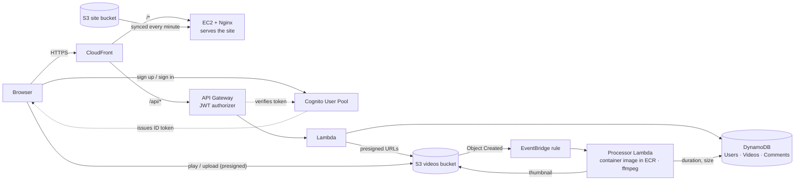

# Cloud Video Platform

A video-sharing platform with real accounts, uploads, likes and comments, built on AWS and deployed entirely from code.

Everything (servers, database, auth, the event-driven video processor) is defined as infrastructure as code and deployed by CI/CD on every push.

**Stack:** Amazon Cognito · API Gateway (HTTP API) · CloudFront · EC2 (Nginx) · Lambda (TypeScript) · S3 · DynamoDB · EventBridge · ECR (container image with ffmpeg) · AWS CDK · GitHub Actions

## Features

- **Accounts:** sign up with email verification, sign in, stay signed in (Cognito).
- **Streaming:** videos are stored in a private S3 bucket and played through 15-minute presigned URLs.
- **Uploads:** any signed-in user can upload an .mp4 (up to 100 MB). The browser sends it straight to S3.
- **Likes and comments** on every video. The author's identity comes from the verified login token, so it can't be faked.
- **Moderation:** members of the Cognito `admins` group can delete any video or comment. Everyone else can only delete their own.
- **Automatic thumbnails:** every upload is processed in the background. A container Lambda running ffmpeg grabs a frame and reads the duration. New uploads show "Processing…" until it finishes; if ffmpeg can't read a video it is marked `failed` and shows "No preview" instead of spinning forever. Admins can backfill thumbnails for older videos (and retry failed ones) with one click.
- **Continue Watching:** playback position is saved every few seconds, and finished videos drop off the list.

## Architecture



| Service | Role |
|---|---|
| **Cognito** | User accounts: sign-up, email verification, sign-in, and the `admins` group |
| **API Gateway** | The only way into the Lambda. Rejects any request without a valid Cognito token. |
| **CloudFront** | One HTTPS domain for the site and the API. Only CloudFront can reach the EC2 server. |
| EC2 | Nginx serves the static site, synced from S3 every minute |
| Lambda | Business logic: catalog, playback, uploads, likes, comments |
| S3 | Private storage for videos and the website files |
| DynamoDB | Users (history, progress, likes), video info, comments |
| **EventBridge** | Routes S3 "Object Created" events for new videos to the processor |
| **ECR** | Stores the processor's container image (Node.js + ffmpeg) |

### Design decisions

- **Identity comes from the token, not the request.** The Lambda reads the user ID and admin group from claims API Gateway has already verified. A user can't impersonate someone by editing a request.
- **Uploads skip the API.** The API returns a presigned S3 POST form, so large files never pass through Lambda or API Gateway, which have small payload limits. S3 itself enforces the 100 MB limit and the content type.
- **The site and API share one domain.** CloudFront routes `/api/*` to API Gateway, so the browser makes no cross-origin calls and CORS isn't needed.
- **Like counts can't drift.** One DynamoDB transaction updates the user's likes and the video's counter together, with a condition that makes double-likes a no-op.
- **Locked-down server.** The EC2 security group only allows CloudFront's IP ranges on port 80, there's no SSH port, and admin access goes through SSM Session Manager.
- **No stored AWS keys.** GitHub Actions signs in to AWS with OIDC: short-lived credentials, limited to this repo's `main` branch.
- **Least privilege.** Each role can only reach the specific tables and bucket folders it needs.
- **Heavy work happens off the request path.** Uploads return immediately; thumbnails are made asynchronously by an event-driven processor, with automatic retries.
- **ffmpeg reads only what it needs.** The processor streams the video from S3 through a presigned URL, so making a thumbnail doesn't download the whole file.
- **A container image for the processor.** ffmpeg is too large and awkward for a zipped Lambda, so the processor ships as a Docker image built by CDK and stored in ECR.

## Project layout

```
bin/app.ts                 CDK app entry point
lib/video-platform-stack.ts       All application infrastructure
lib/github-oidc-stack.ts   Keyless deploy role for GitHub Actions
lambda/api/                Lambda: router (handler.ts) + users, videos, comments, admin
lambda/processor/          Container Lambda (Dockerfile + ffmpeg): thumbnails and duration
site/                      Front end (plain HTML/CSS/JS)
test/                      Jest: helpers, handler authorization, infrastructure assertions
.github/workflows/         Test on every push, deploy on main
```

## Setup (first time)

You need **Node.js 20+**, **git** and the **AWS CLI**.

1. **Install the AWS CLI and sign in.** Install from https://aws.amazon.com/cli/. Then sign in with `aws configure` using an access key for an IAM user with admin rights (or use `aws configure sso`). Check it works:
   ```bash
   aws sts get-caller-identity
   ```
2. **Install dependencies and run the tests.**
   ```bash
   npm ci
   npm test
   ```
3. **Set your GitHub repo** in `cdk.json` → `context.githubRepo`, e.g. `"dguan/cloud-video-platform"`.
4. **Bootstrap CDK** (once per account/region):
   ```bash
   npx cdk bootstrap aws://$(aws sts get-caller-identity --query Account --output text)/us-east-1
   ```
5. **Deploy both stacks:**
   ```bash
   npx cdk deploy --all
   ```
   This takes about 10 minutes; CloudFront is the slow part. Note the outputs: `SiteUrl`, `GitHubDeployRoleArn` and `AddAdminCommand`.
6. **Open `SiteUrl`**, sign up and confirm your email. Wait about a minute after the first deploy for the server to finish setting up.
7. **Make yourself an admin:** run the `AddAdminCommand` output with your email, then sign out and back in.
8. **Add videos:** upload through the site, or in bulk:
   ```bash
   aws s3 cp ./my-videos/ s3://<VideosBucketName>/videos/ --recursive --exclude "*" --include "*.mp4"
   ```

## Continuous deployment

1. In GitHub, go to the repo → **Settings → Secrets and variables → Actions → Variables**. Add `AWS_DEPLOY_ROLE_ARN` = the `GitHubDeployRoleArn` output.
2. Every push to `main` type-checks, runs the tests and deploys `CloudVideoPlatformStack`. Pull requests only run the tests.

The processor is a Docker image, so `cdk deploy` needs Docker. GitHub Actions has it built in. To deploy from your own laptop instead, install [Docker Desktop](https://www.docker.com/products/docker-desktop/) and keep it running while you deploy.

## Cost

Built to stay within the AWS free tier at demo scale. The things that can cost money:
- **EC2 t3.micro:** free-tier eligible.
- **Public IPv4 / Elastic IP:** about $3.60/month, charged whether the instance runs or not, unless covered by free-tier credits.
- **S3 storage** for videos: cents.

Cognito, API Gateway, CloudFront, Lambda and DynamoDB are free at this usage. To remove everything:
```bash
npx cdk destroy --all
```
The videos bucket is kept on purpose, so delete it in the S3 console if you want it gone.
